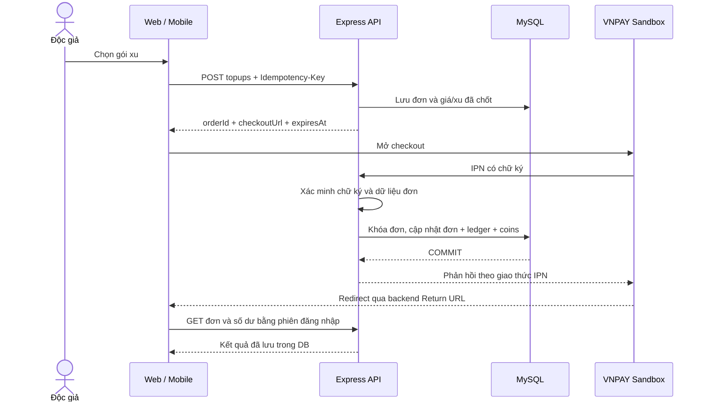

# Kế hoạch tích hợp thanh toán điện tử — MugenBunko

Ngày lập: **27/10/2026**

Nhánh triển khai: **`codex/payment-integration`**

Mục đích: phát triển chức năng thanh toán có thể trình diễn, kiểm thử và giải thích trong đồ án tốt nghiệp.

**Đề xuất khởi đầu:** tích hợp **VNPAY Sandbox**, cho độc giả mua gói xu, theo dõi số dư và lịch sử giao dịch; admin tra cứu và đối soát. Làm chắc luồng này trước khi mở rộng sang ủng hộ tác giả, mở khóa chương hoặc cổng thanh toán thứ hai.

Đây là bản thiết kế đề xuất, chưa phải tính năng đã triển khai. Giá gói, hạn mức, tên module và tiến độ bên dưới là lựa chọn ban đầu để triển khai; có thể điều chỉnh khi chốt nghiệp vụ. Việc chọn VNPAY chưa thay thế bước đăng ký và kiểm tra quyền sử dụng merchant sandbox.

## 1. Hiện trạng đã kiểm tra trong repository

| Thành phần | Hiện trạng | Tác động đến kế hoạch |
| --- | --- | --- |
| Web | React, TypeScript, Vite; `src/App.tsx` quản lý điều hướng bằng hash | Thêm màn hình ví và kết quả thanh toán theo kiến trúc hiện có |
| Mobile | Expo, React Native, Expo Router; dùng chung backend | Có thể đọc cùng số dư/lịch sử và mở checkout sandbox bằng trình duyệt |
| Backend | Express, TypeScript, `mysql2/promise` | Thêm route và service thanh toán; tái sử dụng `db.transaction()` |
| Số dư | `users.coins` tồn tại; kiểu `INT`, mặc định `1000` trong `server/schema.sql` | Chuẩn hóa mặc định và thêm sổ giao dịch trước khi cho nạp |
| Đăng ký | `server/routes/auth.ts` tạo tài khoản mới với `coins = 0` | Schema và code đang khác mặc định; phải thống nhất về `0` |
| API nạp cũ | `POST /api/auth/deposit-coins` luôn trả `403` | Giữ endpoint cũ bị tắt; xây luồng tạo đơn và xác nhận mới |
| Giao dịch | Chưa thấy module cổng thanh toán, bảng đơn nạp hoặc sổ giao dịch xu | Không thể chỉ mở lại endpoint nạp cũ |
| Kiểu dữ liệu | Web và mobile đều có `User.coins: number` | Giữ kiểu số nguyên có giới hạn trong bản đầu |
| Xác thực | Hỗ trợ cookie/Bearer token, kiểm tra tài khoản và phiên trong DB | Route người dùng cần auth; callback cổng có cơ chế xác minh riêng |
| Phân quyền | Có middleware `checkRole`, route admin được bảo vệ riêng | Admin xem và yêu cầu đối soát; moderator không quản lý thanh toán |
| Bảo mật HTTP | Kiểm tra Origin, CORS, rate limit và body parser trong `configureSecurity()` | Phải kiểm tra thứ tự middleware để IPN đến được đúng bộ xác minh |
| Migration | `server/db.ts` quản lý khởi tạo/nâng cấp; production dùng `migrateProduction.ts` | Cập nhật cả migration, schema mới và kiểm tra schema khi khởi động production |
| Scheduler | Có tick định kỳ, hỗ trợ Redis qua `server/shared.ts` | Có thể tái sử dụng điểm lập lịch; tác vụ thanh toán vẫn cần lease trong DB |
| Kiểm thử | `server/tests/fixture.ts` dựng DB riêng, mount danh sách route cụ thể | Bổ sung route và provider giả lập vào fixture, không gọi cổng thật trong test tự động |

Phạm vi khảo sát là mã nguồn tại nhánh hiện tại; chưa kiểm tra dữ liệu database đang chạy hoặc tài khoản merchant thật. Các số dư cũ phải được kiểm kê ở bước migration.

## 2. Phạm vi và tiêu chí hoàn thành

### 2.1. P0 — Bản thanh toán nền tảng

- Độc giả đăng nhập, chọn gói xu và tạo đơn nạp.
- Backend tính giá, tạo URL checkout sandbox và lưu thông tin đơn.
- Cổng gửi kết quả về IPN; backend xác minh và cộng xu đúng một lần.
- Người dùng xem được số dư, lịch sử đơn, sổ giao dịch và chi tiết kết quả.
- Refresh, đóng trình duyệt hoặc mở lại trên thiết bị khác không làm mất giao dịch.
- Có đối soát đơn chưa xác định được kết quả và bảng tra cứu cho admin.
- Có kiểm thử callback giả, callback trùng, đồng thời, sai số tiền và lỗi DB.
- Có kịch bản demo sandbox cùng bằng chứng kiểm thử phục vụ báo cáo.

**Điểm hoàn thành P0:** một giao dịch sandbox đi hết từ chọn gói đến bút toán đã commit; callback lặp hoặc hai API xử lý đồng thời không làm tăng số dư lần thứ hai. Khi callback bị bỏ lỡ, đối soát có thể khôi phục kết quả từ nguồn đã xác minh.

### 2.2. P1 — Nghiệp vụ sử dụng xu, làm sau P0

Đề xuất ưu tiên **ủng hộ tác giả bằng xu nội bộ** để có một câu chuyện nghiệp vụ hoàn chỉnh: nạp xu → đọc truyện → ủng hộ → xem lịch sử. Khi triển khai cần bổ sung giao dịch trừ/cộng cùng transaction, khóa hai tài khoản theo thứ tự ID và chống ủng hộ chính mình.

Xu nhận được từ ủng hộ chưa tự động tạo quyền rút tiền. Việc quy đổi doanh thu, chia phần và chi trả tác giả là một nghiệp vụ riêng, cần được thiết kế trước khi có tiền thật.

### 2.3. P2 — Phần mở rộng

| Hạng mục | Điều kiện trước khi làm |
| --- | --- |
| Mở khóa chương trả phí | Có bảng quyền đọc; chặn nội dung ở mọi API trả chương, cache và dữ liệu tải sẵn; kiểm tra cả web/mobile |
| MoMo hoặc cổng thứ hai | P0 ổn định; có thông tin merchant và test theo giao thức riêng |
| VIP/subscription | Chốt quyền lợi, thời hạn, gia hạn và xử lý hủy/hoàn |
| Voucher, xu thưởng | Tách được xu mua/xu thưởng nếu chính sách sử dụng hoặc hoàn tiền khác nhau |
| Hoàn tiền | Có quy trình hoàn phía cổng và bút toán đảo, kể cả trường hợp xu đã sử dụng |
| Rút tiền tác giả | Chốt đối soát doanh thu, danh tính người nhận, phí và quy trình chi trả |

P0 chưa bao gồm thẻ lưu trên hệ thống, trừ tiền định kỳ, chuyển xu tùy ý giữa người dùng, rút tiền, hay thu tiền thật. Bản demo phải có nhãn **Sandbox — giao dịch thử nghiệm** trên màn hình ví và trang quản trị.

## 3. Lựa chọn cổng thanh toán

| Phương án | Dữ kiện từ tài liệu chính thức | Đề xuất cho đồ án |
| --- | --- | --- |
| VNPAY | Có sandbox; tách URL quay về trình duyệt và IPN cập nhật phía server. [Tài liệu](https://sandbox.vnpayment.vn/apis/docs/thanh-toan-pay/pay.html) | Cổng đầu tiên, nếu đăng ký được thông tin merchant sandbox |
| MoMo | Có môi trường test và production riêng; có hướng dẫn ví/thẻ test. [Tích hợp](https://developers.momo.vn/v3/docs/payment/onboarding/integration-process/), [kiểm thử](https://developers.momo.vn/v3/docs/payment/onboarding/test-instructions/) | Phương án thay thế nếu VNPAY chưa cấp quyền, hoặc cổng thứ hai sau P0 |
| payOS | Tài liệu hiện ghi chưa cung cấp sandbox riêng; thử nghiệm chạy trên production. [Tài liệu môi trường](https://payos.vn/docs/moi-truong-test/) | Không chọn làm mặc định cho bản demo không dùng tiền thật |

Lựa chọn VNPAY là đánh giá theo mục tiêu của dự án, không phải kết luận cổng này có phí thấp nhất hoặc dễ được duyệt nhất. Cần kiểm tra trực tiếp khả năng cấp merchant, đăng ký IPN và API truy vấn trong giai đoạn chuẩn bị; chưa cam kết thời gian phía nhà cung cấp.

Không tích hợp đồng thời nhiều cổng trong P0. Dùng adapter nhỏ, đủ để tách ký/xác minh và truy vấn của VNPAY khỏi nghiệp vụ cộng xu. Mock adapter chỉ dùng cho test và demo cục bộ; hiển thị rõ là mô phỏng.

## 4. Quy tắc nghiệp vụ và gói xu

### 4.1. Bảng giá đề xuất cho sandbox

| Mã gói | Giá trị VND | Xu nhận | Ghi chú |
| --- | ---: | ---: | --- |
| `xu_100` | 10.000 | 100 | Gói nhỏ để demo |
| `xu_500` | 50.000 | 500 | Gói trung bình |
| `xu_1000` | 100.000 | 1.000 | Gói lớn |

Đề xuất tỷ lệ ban đầu: **100 VND = 1 xu**. Đây là giá bán giả định của MugenBunko, chưa bao gồm mô hình phí hoặc doanh thu thực tế. Không có xu khuyến mại trong P0 để giảm nhánh xử lý.

### 4.2. Các quy tắc bắt buộc

1. Client chỉ gửi `packageCode` và loại client hợp lệ; backend lấy giá và xu từ danh mục gói đang bật.
2. Mỗi đơn chụp lại giá, số xu, mã gói, merchant và môi trường tại thời điểm tạo. Sửa gói không làm thay đổi đơn cũ.
3. VND và xu là số nguyên; không dùng số thực để tính giá. Giới hạn đề xuất: tối đa 500.000 VND/đơn và số dư sau cộng không vượt 2.000.000.000 xu, phù hợp `INT` hiện tại.
4. Kiểm tra giới hạn ở cả lúc tạo đơn và transaction cộng xu. Nếu vượt giới hạn khi tiền đã được xác nhận, giữ đơn để xử lý ngoại lệ, không báo đã cấp xu.
5. Một đơn chỉ được cấp xu một lần, dù nhận IPN, truy vấn đối soát hoặc retry nhiều lần.
6. Người dùng chỉ xem đơn/sổ giao dịch của mình; admin có phạm vi đọc riêng.
7. Đóng trang, nhấn Back hoặc quay về app không xác nhận thanh toán thành công hay thất bại.
8. Không cung cấp API nhận trực tiếp `coins`, `amount`, `userId` hoặc `status = paid` để cộng số dư.
9. Số dư local chỉ phục vụ hiển thị. Sau thanh toán phải lấy lại số dư từ API; không cộng xu bằng JavaScript phía client.
10. Xu mua trong P0 không tự hết hạn. Không cho phép đổi xu thành tiền hoặc tự chuyển cho tài khoản khác.

Hạn mức khởi đầu để cấu hình: tối đa 3 đơn chưa ngã ngũ/tài khoản, 5 yêu cầu tạo đơn/phút/tài khoản và thời hạn checkout 15 phút. Đây là hạn mức sản phẩm dự kiến; phải phù hợp cấu hình merchant và được kiểm tra khi triển khai.

## 5. Luồng xử lý từ đầu đến cuối



Thứ tự IPN và redirect trong thực tế có thể đảo nhau. Trang kết quả phải hỗ trợ trạng thái **Đang chờ xác nhận** khi người dùng quay về trước IPN.

### 5.1. Tạo đơn

1. Xác thực phiên, trạng thái tài khoản và kiểm tra cờ cho phép tạo đơn.
2. Kiểm tra gói, hạn mức và `Idempotency-Key`; snapshot dữ liệu ở server.
3. Tạo mã đơn nội bộ và mã tham chiếu gửi cổng, có unique constraint trong DB.
4. Lưu thông tin checkout cố định, thời điểm tạo và hết hạn; chỉ trả URL sau khi dữ liệu cần thiết đã commit.
5. Trả cùng đơn cho retry cùng key và cùng payload. Cùng key nhưng đổi gói/client trả `409`.
6. Đơn đã hết hạn vẫn trả kết quả cũ cho cùng key; người dùng chủ động tạo lần mới với key mới.

### 5.2. Nhận IPN

- Route công khai theo giao thức cổng; không dùng phiên người mua để xác thực callback.
- Kiểm tra định dạng, chữ ký, môi trường/merchant, mã đơn, tiền tệ và số tiền.
- Chỉ cấp xu khi kết quả được adapter phân loại là thanh toán thành công.
- Cập nhật đơn, bút toán, số dư và thông báo trong cùng transaction.
- Trả thành công cho cổng sau commit. Nếu DB không commit được, phản hồi để cổng có thể gửi lại theo giao thức.
- Lần nhận lại không làm thay đổi số dư; phản hồi phù hợp trạng thái đã xử lý.

### 5.3. Người dùng quay về

Return URL đi qua backend rồi chuyển đến trang kết quả đã định sẵn. Backend xác minh dữ liệu quay về nếu có, nhưng **không dùng redirect để cấp xu**.

Trang kết quả gọi API có đăng nhập để đọc đơn. Nếu mất phiên, giữ đường dẫn đơn qua luồng đăng nhập; nếu đổi sang tài khoản khác, không cho đọc đơn đó. Không đưa token đăng nhập, số dư hoặc dữ liệu thẻ vào query/deep link.

### 5.4. Đối soát

Worker lấy các đơn đang chờ hoặc có kết quả chưa rõ, gọi API truy vấn và áp dụng cùng service xác nhận như IPN. Trang người dùng đọc trạng thái trong DB; không để mỗi lần refresh tự gọi API cổng.

## 6. Trạng thái và tình huống ngoại lệ

| Trạng thái đơn | Ý nghĩa | Chuyển tiếp được phép |
| --- | --- | --- |
| `created` | Đã lưu đơn, chưa phát hành checkout thành công | `pending`, `paid`, `failed`, `expired` |
| `pending` | Đã có checkout, đang chờ kết quả | `paid`, `failed`, `cancelled`, `expired` |
| `paid` | Nguồn đã xác minh xác nhận đã thu tiền | Không hạ trạng thái do callback cũ |
| `failed` | Cổng xác nhận thất bại | Chỉ sang `paid` nếu đối soát xác minh lại kết quả mâu thuẫn |
| `cancelled` | Cổng xác nhận hủy | Xử lý mâu thuẫn qua đối soát như `failed` |
| `expired` | Link hết hạn theo giờ server | Có thể sang `paid` khi nhận bằng chứng thanh toán hợp lệ đến muộn |

Tách `fulfillment_status = pending | credited | needs_review` khỏi trạng thái tiền. Bình thường, xác nhận `paid` và `credited` được commit cùng nhau. Nếu tiền được xác nhận nhưng số dư không thể cộng do vượt giới hạn hoặc tài khoản dữ liệu bất thường, lưu `paid + needs_review`, ghi nguyên nhân và đưa vào hàng ngoại lệ; không hiển thị đã nhận xu.

Đơn `needs_review` không kết thúc nghĩa vụ cấp xu. Sau khi xử lý nguyên nhân có audit, yêu cầu đối soát lại để cùng service kiểm tra và cấp đúng snapshot; không tạo đơn thay thế hoặc nhập số xu tùy ý. Nếu nguyên nhân không thể khắc phục, giữ hồ sơ để xử lý hoàn theo phạm vi tiếp theo; đây cũng là lý do chưa bật thu tiền thật trong P0.

| Tình huống | Cách xử lý |
| --- | --- |
| Redirect đến trước IPN | Hiển thị chờ xác nhận, đọc lại có giới hạn |
| Không quay về hoặc đóng app | IPN/worker vẫn xử lý; xem lại trong lịch sử |
| Callback thành công đến sau khi hết hạn local | Vẫn xác minh và cấp xu đúng một lần; lưu thời điểm thực, đánh dấu đến muộn để kiểm tra |
| Callback thất bại đến sau `paid` | Giữ kết quả đã cấp; lưu sự kiện mâu thuẫn để đối soát |
| Callback thành công mâu thuẫn với thất bại đã xác nhận | Không ghi đè tùy ý; worker truy vấn và áp dụng bằng chứng cuối cùng đã xác minh |
| Timeout khi gọi cổng | Giữ kết quả chưa rõ, retry/đối soát; không tự kết luận đã thất bại |
| DB lỗi trước commit | Rollback mọi thay đổi; IPN hoặc worker thử lại |
| Commit xong nhưng phản hồi bị mất | Retry thấy bút toán cũ; không cộng tiếp |
| Tài khoản bị khóa sau khi tạo đơn | Callback vẫn được xử lý và ghi nhận quyền lợi; không bỏ tiền chỉ vì phiên người dùng không còn hợp lệ |
| Admin tắt tạo đơn mới | Đơn cũ vẫn nhận IPN và được đối soát |

Không xóa cứng tài khoản đang liên quan đơn nạp/bút toán. Nếu sau này có yêu cầu xóa tài khoản, thiết kế ẩn danh hóa và lưu chứng từ riêng trước khi mở chức năng đó.

## 7. Thiết kế dữ liệu đề xuất

P0 giữ `users.coins` làm số dư đọc nhanh, bổ sung sổ giao dịch làm căn cứ giải thích biến động. Chưa tạo bảng ví thứ hai để tránh hai nơi giữ số dư.

### 7.1. `coin_packages` — danh mục gói

Các trường chính: `id` kiểu `INT`, `code` kiểu `VARCHAR(32)` duy nhất, `name`, `amount_vnd`, `coin_amount`, `active`, `sort_order`, `created_at`, `updated_at`. API nhận `packageCode`, ví dụ `xu_500`; `package_id` trong đơn là khóa ngoại nội bộ. Giá và xu phải dương. P0 cấu hình gói bằng migration/seed chuyên biệt; chưa cần giao diện sửa bảng giá.

### 7.2. `payment_orders` — đơn nạp

| Nhóm | Các trường chính |
| --- | --- |
| Định danh | `id` UUID; `user_id`; `provider`; `environment`; `merchant_code`; `provider_txn_ref` |
| Snapshot | `package_id`; `package_code`; `amount_vnd`; `coin_amount`; `currency = VND` |
| Kết quả | `status`; `fulfillment_status`; `provider_transaction_id`; `provider_response_code`; `provider_paid_at`; `credited_at`; `review_reason` |
| Retry phía client | `idempotency_key`; `request_fingerprint`; `client = web | native_demo` |
| Thời gian | `created_at`; `updated_at`; `expires_at`; dữ liệu checkout cố định để retry trả cùng link |
| Đối soát | `reconcile_after`; `reconcile_attempts`; `last_reconciled_at`; `lease_owner`; `lease_until` |

Các ràng buộc cần có:

- Unique `(user_id, idempotency_key)`; quy định độ dài và collation phân biệt key rõ ràng.
- Unique `(provider, environment, merchant_code, provider_txn_ref)`.
- Unique transaction ID phía cổng trong cùng provider/environment/merchant khi ID có ý nghĩa; chuẩn hóa giá trị rỗng/placeholder về `NULL`.
- Giá trị VND và xu dương, không vượt giới hạn đã chọn.
- Index `(user_id, created_at, id)` cho lịch sử; index phù hợp cho `(status, reconcile_after, lease_until)`.
- Foreign key đến user không được cascade xóa lịch sử thanh toán. Gói không xóa cứng; dùng `active = false`.

### 7.3. `wallet_entries` — sổ giao dịch xu

Các trường: `id`, `user_id`, `payment_order_id` cho phép null, `entry_type`, `delta_coins`, `balance_after`, `created_at`, `reason`, `migration_key` cho phép null.

P0 dùng `opening_balance` và `topup`. `delta_coins` là số nguyên có dấu để hỗ trợ nghiệp vụ trừ xu về sau; `balance_after` không âm. Với `topup`, số xu phải đúng snapshot của đơn.

- Unique `payment_order_id` cho bút toán cấp xu P0: một đơn không có hai lần cấp.
- Unique `migration_key` cho bút toán số dư đầu kỳ: chạy lại không nhân đôi.
- Index `(user_id, id)` để phân trang; không chỉ dựa vào timestamp vì nhiều bút toán có thể cùng thời điểm.
- Không cung cấp route sửa/xóa bút toán. Sửa sai sau này phải qua bút toán điều chỉnh có liên kết và lý do.

Khi làm hoàn tiền, tách khóa nghiệp vụ cho bút toán đảo hoặc thêm bảng reversal; không bỏ unique chống cấp xu trùng để tái sử dụng bảng.

### 7.4. `payment_events` — dấu vết tiếp nhận

Lưu `id`, `order_id` cho phép null, provider/environment/merchant, `source = ipn | reconciliation | return`, `event_fingerprint`, kết quả xác minh, kết quả xử lý, mã kết quả, mã tham chiếu và thời điểm nhận.

Fingerprint dựa trên các trường nghiệp vụ đã chuẩn hóa, không dựa vào thứ tự query string. Sự kiện lặp được nhận diện nhưng việc chống cộng trùng vẫn do transaction và unique ledger bảo đảm.

Không lưu toàn bộ URL/payload không kiểm soát. Chỉ lưu danh sách trường được phép; loại bỏ thông tin thẻ, bí mật và dữ liệu cá nhân không cần thiết. Request sai chữ ký bị giới hạn log/lưu để tránh biến endpoint thành nơi ghi dữ liệu rác.

### 7.5. `payment_audit` — thao tác quản trị

Lưu actor, hành động, order ID, request ID, lý do và thời điểm cho yêu cầu đối soát, thay cấu hình và xử lý ngoại lệ. P0 không có nút admin tự đánh dấu đã thanh toán hoặc nhập tùy ý số xu.

Nếu retry thông báo cần xử lý ngoài DB, bổ sung outbox có unique theo order. Thông báo nội bộ trong bảng `notifications` có thể tạo ngay trong transaction cấp xu; gửi email không nằm trong P0.

### 7.6. Bất biến dữ liệu cần kiểm tra

```text
users.coins = SUM(wallet_entries.delta_coins) theo từng tài khoản đã chuyển đổi
đơn credited có đúng một entry topup, đúng user và đúng coin_amount
entry topup phải liên kết đơn paid
không có số dư âm hoặc vượt giới hạn
không gộp doanh thu sandbox với dữ liệu tiền thật
```

Xu có sẵn được ghi là `opening_balance`, không tính là doanh thu thanh toán. Trước khi dùng môi trường live phải quyết định cách tách/reset dữ liệu xu thử nghiệm; không mang số dư sandbox sang hệ thống thu tiền thật một cách mặc định.

## 8. Transaction và chống xử lý lặp

### 8.1. Một điểm cấp xu dùng chung

Tạo service dự kiến `applyVerifiedPayment()`, chỉ nhận kết quả đã được adapter xác minh. IPN và worker gọi cùng service; không triển khai hai đoạn cộng xu độc lập.

```text
Xác minh giao thức/chữ ký ngoài transaction.
BEGIN
  SELECT đơn FOR UPDATE.
  So khớp lại provider, môi trường, merchant, tham chiếu và số tiền.
  Nếu đã credited: kiểm tra entry tồn tại, trả kết quả đã xử lý.
  Nếu trạng thái mâu thuẫn: lưu bằng chứng, yêu cầu đối soát theo chính sách.
  SELECT user FOR UPDATE, kể cả user đang bị khóa đăng nhập.
  Kiểm tra số dư hợp lệ và giới hạn.
  Nếu chưa thể cấp: ghi paid + needs_review và bằng chứng; không ghi entry giả.
  Nếu cấp được:
    INSERT wallet_entries với payment_order_id duy nhất.
    UPDATE users SET coins = coins + coin_amount.
    UPDATE payment_orders SET status = paid, fulfillment_status = credited.
    INSERT notification và dấu vết xử lý.
COMMIT
```

Mọi đường ghi giữ cùng thứ tự khóa **order → user**. Dùng phép cộng trên DB sau khi khóa, không đọc số dư ở client rồi ghi đè. Hai đơn cùng tài khoản phải nối tiếp ở khóa user và tạo hai `balance_after` đúng.

Unique ledger là lớp bảo vệ cuối. Nếu gặp duplicate/deadlock hoặc mất kết nối khi chưa biết commit, rollback hoặc mở transaction mới để đọc lại kết quả; không nuốt lỗi rồi tiếp tục cộng. Retry deadlock có giới hạn và giữ nguyên định danh nghiệp vụ.

### 8.2. Phân biệt ba loại retry

| Loại | Cơ chế |
| --- | --- |
| Client gửi lại yêu cầu tạo đơn | Unique idempotency key, fingerprint payload và snapshot checkout |
| Cổng gửi lại cùng giao dịch | Khóa đơn và unique bút toán; trả kết quả theo giao thức |
| Worker hoặc nhiều API đối soát cùng đơn | Lease DB, khóa đơn khi áp dụng kết quả và cùng unique bút toán |

Không giữ transaction/row lock trong lúc gọi mạng tới cổng. Không dùng `Set`, biến toàn cục hoặc Redis lock làm bằng chứng duy nhất rằng đơn đã được cấp xu.

## 9. Hợp đồng API dự kiến

Các URL bên dưới là thiết kế mới, chưa tồn tại trong ứng dụng.

| Method | Endpoint | Quyền | Mục đích |
| --- | --- | --- | --- |
| GET | `/api/payments/packages` | Công khai | Danh sách gói đang bật, cổng/môi trường hiển thị |
| POST | `/api/payments/topups` | Tài khoản active | Tạo hoặc trả lại đơn theo idempotency key |
| GET | `/api/payments/topups` | Đăng nhập | Lịch sử đơn của chính mình, phân trang |
| GET | `/api/payments/topups/:id` | Chủ đơn | Kết quả đơn, tiền/xu, thời gian, trạng thái cấp xu |
| GET | `/api/wallet` | Đăng nhập | Số dư hiện tại từ DB |
| GET | `/api/wallet/entries` | Đăng nhập | Sổ giao dịch của chính mình, phân trang |
| GET | `/api/payments/vnpay/ipn` | Xác minh phía cổng | Nhận và xử lý kết quả theo giao thức VNPAY |
| GET | `/api/payments/vnpay/return` | Công khai | Kiểm tra redirect và đưa về trang kết quả cố định |
| GET | `/api/admin/payments` | Admin | Lọc đơn theo user, thời gian, trạng thái và mã tham chiếu |
| GET | `/api/admin/payments/summary` | Admin | Tổng hợp theo môi trường, phân biệt paid/credited/needs_review |
| POST | `/api/admin/payments/:id/reconcile` | Admin | Xếp lịch truy vấn lại có giới hạn và audit |

Ví dụ tạo đơn:

```http
POST /api/payments/topups
Idempotency-Key: <UUID do client tạo và giữ khi retry>
Content-Type: application/json

{"packageCode":"xu_500","client":"web"}
```

```json
{
  "orderId": "<UUID>",
  "status": "pending",
  "fulfillmentStatus": "pending",
  "amountVnd": 50000,
  "coinAmount": 500,
  "environment": "sandbox",
  "checkoutUrl": "<URL do backend tạo>",
  "expiresAt": "<ISO 8601>"
}
```

Lần tạo mới trả `201`, retry hợp lệ trả `200`. Đơn không thuộc người gọi trả `404` để hạn chế lộ định danh. Dữ liệu ví, đơn và admin dùng `Cache-Control: private, no-store`.

Lỗi nghiệp vụ có mã ổn định như `PACKAGE_UNAVAILABLE`, `IDEMPOTENCY_CONFLICT`, `TOO_MANY_PENDING_ORDERS`, `PAYMENTS_DISABLED`, `PAYMENT_REVIEW_REQUIRED`. Không trả secret, chuỗi ký hoặc chi tiết SQL. Với IPN, mã HTTP và body phản hồi phải theo giao thức cổng, không dùng chung cấu trúc lỗi REST của client.

Phân trang đề xuất 20 mục/lần, tối đa 50; dùng cursor `(created_at, id)` cho đơn và `id` cho ledger. Endpoint tổng hợp admin dùng khoảng thời gian có giới hạn, không quét toàn bộ bảng mỗi lần mở dashboard.

## 10. Adapter VNPAY và middleware

### 10.1. Các điểm giao thức phải xác minh

VNPAY mô tả IPN qua GET, số tiền gửi cổng theo đơn vị `VND × 100`, dữ liệu ký cần sắp xếp/encode đúng và thời gian checkout theo GMT+7. Dùng HMAC-SHA512 cho cấu hình tích hợp dự kiến; đối chiếu phiên bản merchant trước khi viết adapter. [Hướng dẫn PAY](https://sandbox.vnpayment.vn/apis/docs/thanh-toan-pay/pay.html)

Checklist adapter:

- Hàm tạo canonical string và ký có test vector cố định, bao gồm khoảng trắng, dấu `+`, Unicode và percent encoding.
- Loại trường chữ ký khỏi dữ liệu kiểm tra đúng quy tắc; từ chối query lặp key, array/object thay cho scalar và hash sai định dạng.
- So chữ ký bằng API so sánh thời gian hằng khi độ dài hợp lệ.
- Kiểm tra đồng thời kết quả giao dịch và trạng thái giao dịch theo đặc tả; URL đúng chữ ký chưa đủ để cấp xu.
- Lưu thời gian nội bộ thống nhất UTC; chuyển GMT+7 ở biên giao thức, hiển thị theo `Asia/Ho_Chi_Minh`.
- Chụp và lưu `CreateDate`/tham chiếu cần cho truy vấn; không tạo lại tùy ý khi retry.
- API truy vấn có cấu trúc ký/xác minh riêng; đối chiếu đơn, merchant, số tiền và ID giao dịch trước khi áp dụng. [Tài liệu truy vấn](https://sandbox.vnpayment.vn/apis/docs/truy-van-hoan-tien/querydr%26refund.html)
- Chốt bảng phản hồi IPN cho hợp lệ, trùng, không tìm thấy đơn, sai tiền, sai chữ ký và lỗi tạm thời từ tài liệu merchant tại lúc triển khai; không tự đoán mã phản hồi.

### 10.2. Kiểm tra middleware hiện có

`configureSecurity()` chạy Origin check và limiter trước route. Cần xử lý callback bằng ngoại lệ **đúng method + đúng path**, nếu giao thức yêu cầu; không mở toàn bộ `/api/payments`.

- Route IPN không yêu cầu cookie/Bearer/Origin của trình duyệt người mua; dựa vào chữ ký và nội dung đã đối chiếu.
- Giữ Origin/CSRF hiện có cho API tạo đơn và admin. Không coi CORS hoặc IP allowlist là bằng chứng thanh toán.
- Có giới hạn request riêng cho IPN; tránh limiter dùng chung khiến retry hợp lệ bị chặn hàng loạt.
- VNPAY GET không cần đổi sang raw-body. Nếu thêm cổng POST sau này, kiểm tra yêu cầu raw body của đúng giao thức trước body parser.
- IPN/Return phải được mount trước static SPA fallback và API 404; không bị redirect sang trang đăng nhập hay mobile gate.
- Kiểm tra header proxy tin cậy khi lấy IP cho checkout; không tin `X-Forwarded-For` từ mọi client.
- Redact query thanh toán trong reverse-proxy access log và công cụ giám sát, vì IPN/Return dùng query string.

Return chỉ dùng destination đã cấu hình; loại client lấy từ đơn. Không nhận `returnUrl` tùy ý từ request và không phản chiếu HTML từ query.

## 11. Thiết kế giao diện web và mobile

### 11.1. Web: `#/wallet`

Điểm vào từ hồ sơ cá nhân; chỉ thêm số dư vào header nếu phù hợp bố cục hiện tại. Bố cục gồm số dư → chọn gói → đơn đang chờ → lịch sử. Mỗi gói hiển thị rõ **số tiền VND** và **số xu nhận**, một CTA chính “Tiếp tục thanh toán”.

- Dùng token Washi/Sepia/Charcoal hiện có, nút chính màu mực, Sakura cho nhấn chọn và focus.
- Tái sử dụng `PageLoading`, `PageError`, `Icons`; CSS riêng trong `src/styles/wallet.css`.
- Có loading, lỗi có retry, lịch sử trống, hết phiên, tạo đơn đang chạy và gói ngừng bán.
- Giữ gói đang chọn khi tạo đơn lỗi; khóa double click nhưng vẫn dựa vào idempotency phía server.
- Không hiển thị lịch sử giao dịch ở hồ sơ công khai của người khác.

### 11.2. Web: `#/payment/result/:orderId`

| Trạng thái hiển thị | Nội dung và hành động |
| --- | --- |
| Chờ xác nhận | Giải thích đang chờ server; cho xem lịch sử và kiểm tra lại |
| Thành công, đã cấp xu | Hiển thị VND, xu, mã đơn, thời gian; CTA về ví |
| Đã xác nhận tiền, cần xử lý cấp xu | Nêu rõ đang xử lý; không khuyến khích thanh toán lại cùng đơn |
| Thất bại/hủy/hết hạn | Hiển thị đúng kết quả đã lưu; CTA tạo giao dịch mới |
| Mất mạng | Giữ mã đơn; thông báo chưa đọc được kết quả, có retry |
| Chưa đăng nhập | Đăng nhập rồi quay lại đúng trang kết quả |

Khi đang chờ, đọc lại sau khoảng 2/4/8/15 giây, sau đó tối đa mỗi 15 giây trong 2 phút. Dừng khi tab ẩn, component unmount hoặc đạt trạng thái cuối; mở lại tab thì refresh một lần. Đây là nhịp UX dự kiến, không phải lịch gọi cổng.

Các điểm điều hướng phải sửa cùng nhau: `getInitialRoute`, xử lý hash change, đồng bộ view/hash, bảo vệ phiên trong `src/App.tsx` và allowlist `safeAuthReturn()` tại `src/utils/authNavigation.ts`. Kiểm tra back/forward/reload và đăng nhập quay lại đơn.

### 11.3. Mobile

- Màn hình mới dự kiến `mobile/app/wallet.tsx` và `mobile/app/payment/result.tsx`, mở từ tab Cá nhân.
- Tái sử dụng API client, AuthContext, palette và primitive native hiện có.
- Backend dùng chung, không đặt secret trong `EXPO_PUBLIC_*`.
- Bản demo dùng trình duyệt hệ thống/`expo-web-browser` đã có trong dependencies; không nhập thông tin thẻ trong WebView của app.
- Scheme hiện có là `mugenbunko`; deep link chỉ mang order ID. Backend chọn đích từ cấu hình và loại client đã lưu.
- Nếu deep link không mở được, trang kết quả web vẫn có mã đơn và hướng dẫn quay lại ví.
- Khi app trở lại foreground, lấy lại đơn và số dư; không coi việc browser đóng là giao dịch thành công.
- Kiểm tra thật trên Android/emulator; hành vi iOS cần thiết bị/môi trường phù hợp. Expo web không chứng minh deep link native hoạt động.

Trước khi phát hành qua store, đánh giá luồng mua xu/nội dung số theo [Apple App Review 3.1.1](https://developer.apple.com/app-store/review/guidelines/#in-app-purchase) và [Google Play Payments](https://support.google.com/googleplay/android-developer/answer/9858738?hl=en). Các chính sách có yêu cầu và ngoại lệ theo hình thức phân phối/thị trường; không lấy luồng mở cổng ngoài của bản demo làm kết luận đã sẵn sàng phát hành store.

### 11.4. Quản trị

Thêm khu vực thanh toán trong `AdminDashboard` hoặc page con theo cấu trúc hiện có: bộ lọc đơn, chi tiết sự kiện, đơn chờ lâu, đơn `needs_review`, tổng số tiền được cổng xác nhận và số xu đã cấp.

Luôn hiện nhãn môi trường. Nút “Đối soát lại” chỉ xếp việc truy vấn cổng, có cooldown, lý do và audit; không tự sửa số dư hay đánh dấu đơn đã thanh toán.

## 12. Migration và vận hành

### 12.1. Chuyển dữ liệu cũ

1. Sao lưu và thử migration trên DB bản sao; kiểm kê `coins IS NULL`, số dư âm và giá trị ngoài giới hạn.
2. Tạm dừng mọi đường ghi xu trong thời gian chuyển đổi. Không dùng một snapshot rồi để writer cũ tiếp tục chạy.
3. Tạo bảng/index/ràng buộc; chuẩn hóa mặc định `users.coins` về `0`. Số dư đang có không bị reset.
4. Với mỗi user, tạo đúng một `opening_balance` bằng số dư đã kiểm kê; ghi cả mốc 0 để xác định đã chuyển đổi.
5. Dùng migration key ổn định theo version/user; thực hiện theo batch và có thể resume. MySQL DDL có thể implicit commit, nên không coi cả migration schema và backfill là một transaction rollback được.
6. So tổng ledger với `users.coins` cho từng tài khoản và tổng toàn bộ; xử lý dữ liệu bất thường bằng quyết định có dấu vết, không âm thầm cắt về 0.
7. Chạy lại migration để xác nhận không thêm opening entry, không nhân đôi gói hoặc đổi số dư.
8. Kiểm tra đăng ký mới nhận 0 xu và ledger ban đầu tương ứng; cập nhật script seed đang chèn xu mẫu để đi qua cơ chế dành cho dữ liệu demo.

Tích hợp schema mới và migration dự kiến `server/paymentSchema.ts`, `server/paymentSchemaMigration.ts` vào `initializeDbConnection()`. Nhánh production không tự migrate cần kiểm tra các bảng/cột thanh toán trước khi phục vụ; không để đến IPN đầu tiên mới phát hiện thiếu schema.

### 12.2. Cấu hình dự kiến

```dotenv
# Chỉ là tên biến đề xuất; dùng giá trị thật ngoài repository.
PAYMENTS_ENABLED=false
PAYMENT_PROVIDER=vnpay
PAYMENT_ENV=sandbox
VNPAY_TMN_CODE=
VNPAY_HASH_SECRET=
VNPAY_PAYMENT_URL=https://sandbox.vnpayment.vn/paymentv2/vpcpay.html
VNPAY_QUERY_URL=https://sandbox.vnpayment.vn/merchant_webapi/api/transaction
PAYMENT_PUBLIC_BASE_URL=https://<backend-public>
PAYMENT_WEB_BASE_URL=https://<frontend-public>
PAYMENT_NATIVE_RETURN_URL=mugenbunko://payment/result
PAYMENT_ORDER_TTL_MINUTES=15
PAYMENT_RECONCILE_ENABLED=true
PAYMENT_MAX_AMOUNT_VND=500000
PAYMENT_MAX_BALANCE_COINS=2000000000
```

`PAYMENTS_ENABLED` kiểm soát tạo checkout mới, không tắt tiếp nhận/đối soát đơn đang tồn tại. Không cho config live dùng endpoint sandbox hoặc ngược lại. Tách secret, DB và merchant của test/staging/live; giữ key phiên bản cũ đủ để xử lý đơn đang chờ khi xoay khóa.

Chỉ thêm placeholder vào `server/.env.example` và tài liệu; không commit `.env`, secret, URL checkout của đơn thật hoặc dữ liệu thẻ. Nếu dự án dùng Docker Compose, khai báo truyền biến vào đúng service và giữ bí mật ngoài image.

### 12.3. Đối soát và worker

- Giai đoạn đầu chạy một worker logic trong scheduler hiện có; kiểm tra cờ scheduler và tách cấu hình tác vụ thanh toán rõ ràng.
- Mỗi lần claim một batch nhỏ bằng DB lock/lease có hạn. Có thể dùng `FOR UPDATE SKIP LOCKED` trên MySQL 8; commit claim rồi mới gọi cổng.
- Lease hết hạn cho phép worker khác tiếp tục sau crash. Khi ghi kết quả kiểm tra lại lease/trạng thái và vẫn dùng transaction chống cộng lặp.
- Retry có backoff/jitter; timeout theo giao thức và hạn mức merchant, không áp một timeout cho mọi cổng.
- Đơn pending lâu được đối soát; đơn hết hạn local vẫn còn cửa sổ đối soát đề xuất 48 giờ. Sau cửa sổ đưa vào hàng cần kiểm tra, không xóa hoặc suy ra chắc chắn chưa thu tiền.
- Với đơn thất bại/hủy có sự kiện mâu thuẫn, ưu tiên truy vấn lại. Endpoint admin chỉ đẩy nhanh lịch này.
- Bắt lỗi theo từng đơn để một giao dịch lỗi không dừng cả batch. Không để tác vụ xuất bản chương bị treo vì truy vấn thanh toán chậm.

### 12.4. Quan sát và khôi phục

Log có request ID, order ID, nguồn sự kiện và kết quả xử lý; không ghi secret hoặc đầy đủ query. Metric gồm số đơn, tỷ lệ xác nhận/cấp xu, callback sai chữ ký, callback lặp, tuổi đơn chờ, số lần đối soát và đơn ngoại lệ.

Không đưa user ID/order ID vào nhãn metric có số giá trị lớn. Có báo cáo kiểm tra ledger theo tài khoản; chênh lệch tạo cảnh báo để điều tra, không tự sửa số dư.

Khi có sự cố: tắt tạo đơn mới → giữ IPN/worker hoạt động nếu có thể → xác định các đơn liên quan → khôi phục DB từ bản sao ở môi trường riêng → đối soát với cổng trước khi cấp/đảo xu. Nếu DB phải phục hồi về thời điểm cũ, callback và truy vấn lại vẫn phải chống cấp trùng theo dữ liệu đã khôi phục và bằng chứng phía cổng.

Rollback ứng dụng ưu tiên tắt feature hoặc quay về bản vẫn hiểu schema thanh toán. Không xóa bảng/ledger khi đã có đơn, và không chạy đồng thời bản code cũ còn ghi `coins` ngoài service mới.

## 13. Các file dự kiến tạo hoặc thay đổi

| Khu vực | File/module | Công việc |
| --- | --- | --- |
| Dữ liệu | `server/schema.sql`, `server/db.ts`, `server/migrateProduction.ts` | Schema mới, migration, kiểm tra production; chỉ sửa nơi cần tích hợp |
| Dữ liệu mới | `server/paymentSchema.ts`, `server/paymentSchemaMigration.ts` | Bảng/index, backfill opening balance và kiểm tra bất biến |
| Nghiệp vụ | `server/payments/paymentService.ts`, `walletService.ts` | Tạo đơn, idempotency, cấp xu và lịch sử |
| Cổng | `server/payments/providers/types.ts`, `vnpay.ts`, provider test | Adapter, ký/xác minh và truy vấn |
| Đối soát | `server/payments/reconcile.ts` | Claim/lease, retry và xử lý kết quả |
| API | `server/routes/payments.ts`, `wallet.ts`, route admin hiện có hoặc module admin mới | API người dùng, IPN/Return và quản trị |
| Khởi động/bảo mật | `server/server.ts`, `server/config.ts`, `server/middleware/security.ts`, `limits.ts` | Mount route, config, scheduler và xử lý callback đúng phạm vi |
| Cấu hình triển khai | `server/.env.example`, `docker-compose.yml`, cấu hình proxy liên quan | Truyền biến, bảo vệ log và callback public |
| Web | `src/pages/Wallet.tsx`, `PaymentResult.tsx`, `src/styles/wallet.css` | Ví, gói, lịch sử và trang kết quả |
| Điều hướng web | `src/App.tsx`, `src/utils/authNavigation.ts`, hồ sơ/header | Hash route, refresh số dư và điểm vào |
| Kiểu dữ liệu | `src/types/index.ts`, `mobile/src/types/index.ts` hoặc module payment riêng | DTO và trạng thái; cân nhắc dùng `shared/` nếu hợp build hai phía |
| Mobile | `mobile/app/wallet.tsx`, `mobile/app/payment/result.tsx`, API service mới | Ví, trình duyệt checkout sandbox và trở lại ứng dụng |
| Test | `server/tests/payments.test.ts`, `paymentMigration.test.ts`, fixture và browser test | Nghiệp vụ, migration, callback và luồng người dùng |
| Tài liệu | `README.md`, tài liệu vận hành thanh toán | Hướng dẫn sandbox, test, sơ đồ và kịch bản demo |

Tên file là dự kiến, không yêu cầu tạo mọi lớp ngay từ đầu. Ưu tiên service nhỏ và adapter rõ trách nhiệm, tránh bổ sung framework hoặc hệ thống queue mới chỉ cho một cổng sandbox.

## 14. Lộ trình triển khai và đầu ra từng giai đoạn

Ước lượng cho một người đã quen repo: **15–20 ngày làm việc cho P0 có web và mobile demo**, chưa gồm thời gian chờ merchant, đánh giá store hoặc thu tiền thật. Có thể cắt mốc demo web sau G4 nếu lịch bảo vệ ngắn.

| Giai đoạn | Thời lượng dự kiến | Việc cần làm | Điều kiện chuyển bước |
| --- | --- | --- | --- |
| G0 — Chốt đường tích hợp | 1 ngày | Đăng ký merchant sandbox, xác nhận IPN/query API, chọn gói và dựng URL HTTPS public | Có thông tin test hợp lệ; xác định phương án thay thế nếu chưa được cấp |
| G1 — Nền dữ liệu | 2–3 ngày | Schema, backfill, mặc định xu 0, ledger và ràng buộc | Migration chạy lại được, số dư cũ khớp, đăng ký mới đúng |
| G2 — Service và test cốt lõi | 3 ngày | Tạo đơn, idempotency, áp dụng kết quả, giả lập lỗi và xử lý đồng thời | Test chống cấp trùng/rollback qua DB thật đạt |
| G3 — VNPAY và đối soát | 2–3 ngày | Adapter, IPN/Return, middleware, truy vấn, worker lease | Sandbox cấp xu; bỏ lỡ IPN có thể khôi phục bằng truy vấn |
| G4 — Web và admin | 2–3 ngày | Ví, trang kết quả, lịch sử, auth return và tra cứu admin | Đi hết luồng web; reload/back/forward và các trạng thái lỗi đúng |
| G5 — Mobile demo | 2–3 ngày | Ví native, mở browser, deep link/foreground refresh | Một thiết bị/emulator thật đi hết luồng; ghi rõ phạm vi iOS đã thử |
| G6 — Hoàn thiện đồ án | 3–4 ngày | Regression, thử staging, vận hành, ảnh/video và tài liệu | Checklist nghiệm thu đạt, demo có thể lặp lại |

G0 có thể làm song song với G1 theo tiến độ cá nhân; G2 dùng adapter test trong lúc chờ merchant. G3 chỉ được coi là xong khi chạy với sandbox thật. P1 ủng hộ tác giả dự kiến thêm 3–5 ngày sau P0; chưa tính vào ước lượng trên.

### Thứ tự commit gợi ý

1. `feat(payments): add payment schema and opening balance migration`
2. `feat(payments): add idempotent topups and wallet ledger`
3. `feat(payments): integrate vnpay sandbox and reconciliation`
4. `feat(wallet): add web checkout result and payment admin views`
5. `feat(mobile): add sandbox wallet checkout and return flow`
6. `docs(payments): add sandbox setup and graduation demo guide`

Mỗi commit nghiệp vụ đi kèm test liên quan. Không bật feature trước khi có schema, xác nhận callback và đối soát tối thiểu.

## 15. Kế hoạch kiểm thử

### 15.1. Bộ test bắt buộc

| ID | Tình huống | Kết quả cần đạt |
| --- | --- | --- |
| PAY-01 | Tạo đơn với gói đang bật | Giá/xu đúng dữ liệu server, lưu snapshot |
| PAY-02 | Client sửa giá, xu hoặc user ID | Không thể tác động đơn/số dư bằng dữ liệu tự gửi |
| PAY-03 | Chưa đăng nhập hoặc tài khoản bị khóa tạo đơn | Bị từ chối, không tạo checkout |
| PAY-04 | Cùng key/cùng payload gửi lại, kể cả đồng thời | Một đơn, cùng dữ liệu checkout |
| PAY-05 | Cùng key nhưng đổi gói/client | `409`, không tạo đơn khác |
| PAY-06 | IPN thành công hợp lệ | Một entry, tăng đúng số dư, đơn credited |
| PAY-07 | IPN cùng đơn gửi 10 lần hoặc hai API xử lý cùng lúc | Tổng xu chỉ tăng một lần |
| PAY-08 | Hai đơn khác nhau cùng tài khoản | Cộng đủ cả hai, ledger có balance_after nhất quán |
| PAY-09 | Sai hash, sai định dạng hash, query lặp key | Không cấp xu, phản hồi đúng giao thức |
| PAY-10 | Đúng chữ ký nhưng sai tiền, merchant hoặc môi trường | Không cấp xu; ghi dấu vết phù hợp |
| PAY-11 | Cùng transaction ID cổng dùng cho hai đơn | Không thể cấp xu cho cả hai |
| PAY-12 | Mã đơn không tồn tại | Không tạo user/đơn hoặc cấp xu từ callback |
| PAY-13 | Redirect giả hoặc redirect thành công trước IPN | Số dư không đổi chỉ vì redirect; UI chờ |
| PAY-14 | Đóng browser/app, thanh toán xong rồi mở lại | Lịch sử/số dư vẫn nhận đúng kết quả |
| PAY-15 | Đơn hết hạn local, callback thành công đến muộn | Cấp xu đúng một lần sau xác minh, lưu thời điểm thực |
| PAY-16 | Callback cũ thất bại sau khi đã paid | Không hạ kết quả hoặc trừ xu |
| PAY-17 | Lỗi DB giữa insert ledger và update coins | Toàn bộ transaction rollback |
| PAY-18 | Commit xong nhưng mất phản hồi IPN | Retry nhận diện đã xử lý, không cộng tiếp |
| PAY-19 | Worker và IPN xử lý cùng đơn | Một lần cấp, không mất kết quả |
| PAY-20 | Worker crash sau claim, trước/sau gọi cổng | Lease hết hạn cho phép tiếp tục; không mất đơn |
| PAY-21 | Query timeout hoặc trả sai chữ ký/sai số tiền | Chưa kết luận thành công, retry có giới hạn |
| PAY-22 | Người khác đoán ID đơn, cursor hoặc gọi admin | Không đọc được dữ liệu ngoài quyền |
| PAY-23 | Tài khoản bị khóa sau khi tạo đơn | Callback vẫn ghi nhận, quyền đăng nhập vẫn bị khóa |
| PAY-24 | Tắt tạo đơn mới khi còn đơn pending | Không tạo mới; IPN và đối soát cũ vẫn chạy |
| PAY-25 | Migration trên user 0 xu và user có xu, chạy lại | Giữ nguyên số dư, một opening entry/user |
| PAY-26 | Migration gặp null/âm/ngoài giới hạn | Báo lỗi cần xử lý, không tự đổi số dư |
| PAY-27 | Vượt giới hạn số dư tại lúc xác nhận | Tiền được ghi nhận và vào hàng ngoại lệ, không cấp xu sai |
| PAY-28 | URL checkout có Unicode/khoảng trắng, máy chạy timezone khác | Chữ ký và thời gian đúng test vector |
| PAY-29 | Phiên hết hạn trên trang kết quả | Đăng nhập quay lại đúng đơn; đổi tài khoản không lộ đơn |
| PAY-30 | Mobile browser đóng, deep link lỗi hoặc app bị kill | Không báo thành công giả; mở ví đọc lại kết quả |
| PAY-31 | Gói bị tắt/thay giá khi đơn cũ còn chờ | Đơn cũ dùng snapshot; đơn mới theo cấu hình mới |
| PAY-32 | API restart hoặc có nhiều replica | Không phụ thuộc trạng thái trong RAM; idempotency còn hiệu lực |

### 15.2. Tách môi trường test

- Unit/contract test: test vector ký/xác minh và provider giả lập, không gọi internet.
- Integration test: MySQL fixture riêng, mount đầy đủ routes mới; kiểm tra transaction, khóa, unique, migration và lỗi có chủ đích.
- Worker test: điều khiển giờ/lease, timeout và retry để không phải chờ thời gian thật nhiều phút.
- Browser test: gói → tạo đơn → chờ → thành công/lỗi bằng provider giả lập; kiểm tra cả 3 theme, bàn phím và bố cục hẹp sau bypass mobile gate.
- Sandbox E2E: chạy thủ công bằng tài khoản test chính thức, gồm IPN tới HTTPS public và tình huống truy vấn lại. Không dùng tài khoản/thẻ thật.
- Native smoke: mở browser, foreground refresh và deep link trên thiết bị/emulator; ghi rõ platform đã xác minh.

### 15.3. Lệnh kiểm tra

Các lệnh hiện có, chạy theo phạm vi thay đổi ở giai đoạn triển khai:

```powershell
npm run typecheck
npm run build
npm run lint
npm --prefix server run build
npm --prefix server run test:security
npm --prefix mobile run typecheck
```

Đề xuất bổ sung script `test:payments`, `test:payments:migration`, `test:payments:browser` vào package tương ứng. Các script này **chưa tồn tại**; thêm khi viết test, không coi chúng là lệnh đang chạy được.

Test đối soát/đồng thời phải đi qua DB thật, không chỉ kiểm tra mock trả về đúng. Test thanh toán tự động không được liên hệ merchant live, SMTP hoặc database production.

## 16. Checklist nghiệm thu và demo bảo vệ

### 16.1. Checklist P0

- [ ] Merchant sandbox và callback HTTPS hoạt động.
- [ ] Luồng chọn gói → checkout → xác nhận → nhận xu hoàn chỉnh.
- [ ] Không có đường nạp trực tiếp hoặc sửa xu từ client.
- [ ] Callback/đối soát lặp và đồng thời chỉ tạo một lần cấp xu.
- [ ] Có sổ giao dịch khớp số dư, migration không reset xu cũ.
- [ ] Phân biệt đã thu tiền và đã cấp xu; có danh sách ngoại lệ.
- [ ] Đối soát phục hồi được đơn khi IPN không đến.
- [ ] Lịch sử và trang kết quả chịu được reload, hết phiên và mất mạng.
- [ ] Admin tra cứu/đối soát có phân quyền và audit.
- [ ] Đóng browser/app không làm mất kết quả, không báo thành công giả.
- [ ] Sandbox hiển thị rõ; không có bí mật trong Git/build frontend/log.
- [ ] Có bằng chứng test, giới hạn đã biết và hướng dẫn vận hành.

### 16.2. Kịch bản demo khoảng 8–10 phút

1. Đăng nhập độc giả, hiển thị số dư và lịch sử trước thanh toán.
2. Chọn gói 50.000 VND → 500 xu, giải thích giá do backend chốt.
3. Hoàn thành checkout sandbox; quay về và cho xem xu đã tăng cùng ledger.
4. Refresh/mở lại trang để cho thấy dữ liệu do server lưu.
5. Trình diễn callback lặp bằng công cụ test có kiểm soát; số dư giữ nguyên.
6. Tạo một giao dịch hủy hoặc thất bại; không nhận xu.
7. Admin xem đơn, sự kiện và một tình huống đối soát khi IPN bị bỏ lỡ trong môi trường test.
8. Nếu đạt G5, mở mobile để xem cùng số dư/lịch sử và trình diễn quay lại app.

Chuẩn bị sẵn đơn mẫu và video dự phòng. Nếu sandbox mất kết nối, dùng demo provider có nhãn **Mô phỏng** và nói rõ bằng chứng sandbox đã quay trước; không trình bày dữ liệu mô phỏng như giao dịch cổng thật.

Đầu ra cho báo cáo: sơ đồ use case và sequence, mô hình quan hệ mới, bảng trạng thái, hợp đồng API, test case/kết quả, ảnh các trạng thái giao diện, cùng giải thích cơ chế chống cộng xu trùng và giới hạn của bản sandbox.

## 17. Các quyết định cần chốt khi bắt đầu code

| Quyết định | Mặc định của plan | Khi nào cần xem lại |
| --- | --- | --- |
| Cổng đầu tiên | VNPAY Sandbox | G0: merchant không được cấp hoặc API cần thiết không dùng được |
| Nghiệp vụ P0 | Nạp xu, ví, lịch sử, đối soát | Trước G1 nếu mục tiêu đồ án chuyển sang mua trực tiếp |
| Giá gói | 10k/50k/100k tương ứng 100/500/1.000 xu | Trước seed gói; chỉ là giá đề xuất |
| Số dư cũ | Giữ nguyên, ghi opening balance | Khi có kết quả kiểm kê DB |
| Sử dụng xu | Ủng hộ tác giả ở P1 | Sau khi P0 đã nghiệm thu |
| Phạm vi mobile | Demo sandbox, chưa coi là phát hành store | Trước khi đóng gói phát hành công khai |
| Tiền thật | Chưa bật trong P0 | Cần phạm vi riêng: merchant live, dữ liệu xu thử, hoàn tiền, vận hành và chính sách áp dụng |

**Bước triển khai đầu tiên:** xác nhận merchant sandbox và hoàn thành migration/sổ giao dịch; tiếp theo viết service cấp xu cùng test chống xử lý lặp. Chỉ nối checkout vào giao diện khi lớp dữ liệu và xác nhận đã có kiểm thử.

## 18. Nguồn tham khảo

Tài liệu công khai được tra cứu ngày 27/10/2026. Khi code cần đối chiếu lại phiên bản được cấp cho merchant; ví dụ tích hợp công khai có thể khác hợp đồng đang sử dụng.

- [VNPAY — tích hợp PAY, IPN và Return URL](https://sandbox.vnpayment.vn/apis/docs/thanh-toan-pay/pay.html).
- [VNPAY — API truy vấn và hoàn tiền](https://sandbox.vnpayment.vn/apis/docs/truy-van-hoan-tien/querydr%26refund.html).
- [MoMo — môi trường và quy trình tích hợp](https://developers.momo.vn/v3/docs/payment/onboarding/integration-process/).
- [MoMo — hướng dẫn kiểm thử](https://developers.momo.vn/v3/docs/payment/onboarding/test-instructions/).
- [payOS — môi trường test](https://payos.vn/docs/moi-truong-test/).
- [Apple — quy định thanh toán nội dung số trong App Review Guidelines](https://developer.apple.com/app-store/review/guidelines/#in-app-purchase).
- [Google Play — Payments policy](https://support.google.com/googleplay/android-developer/answer/9858738?hl=en).

Nguồn nội bộ để cập nhật plan khi code thay đổi: `server/schema.sql`, `server/db.ts`, `server/routes/auth.ts`, middleware auth/security/roles, `server/server.ts`, `server/tests/fixture.ts`, `src/App.tsx`, `src/utils/authNavigation.ts`, `mobile/app.json`, `mobile/src/services/api/client.ts` và skill thiết kế frontend của repository.
